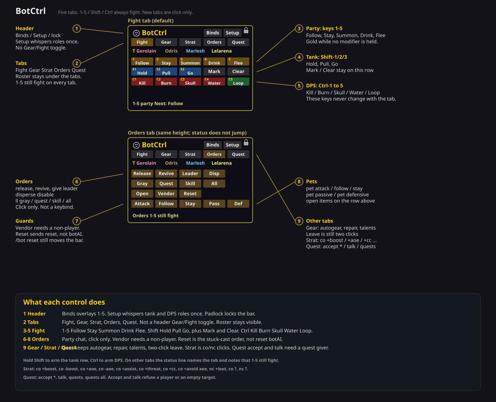

# BotCtrl

Playerbot commander for **World of Warcraft 3.3.5a** (Interface 30300). Clickable pad plus optional 1–5 / Shift / Ctrl binds. Names come from the party roster — nothing is hardcoded.

Tabs sit under the title: **Fight**, **Gear**, **Strat**, **Orders**, **Quest**. The roster stays on every tab. The frame height is fixed, so the status line does not jump. Combat keys always fire the Fight commands, whichever tab is visible. They never send `autogear`, `leave`, or Strat / Orders / Quest chat.



## Install

Unzip the GitHub download. Copy the inner **BotCtrl** folder (the one that contains `BotCtrl.toc`) into:

```
Interface/AddOns/BotCtrl
```

Do not copy the outer folder that also has this README — WoW only loads a folder that has `BotCtrl.toc` at its top level.

Enable **BotCtrl** at character select. `/reload` after updates.

## Fight tab (default)

`/bot fight` or `/bot combat`. The page id is `combat`, so older `/bot fight` still lands here.

| Row | Buttons |
| --- | --- |
| Party | 1 Follow, 2 Stay, 3 Summon, 4 Drink, 5 Flee |
| Tank | Shift-1 Hold, Shift-2 Pull, Shift-3 Go, **Mark**, **Clear** |
| DPS | Ctrl-1 Kill, Ctrl-2 Burn, Ctrl-3 Skull, Ctrl-4 Water, Ctrl-5 Loop |

**Setup** stays in the header. Hold Shift or Ctrl to highlight the live row. Click **Binds** to overlay 1–5 (does not permanently steal the action bar). `/bot unbind` restores it.

Status line shows the live modifier, the next loop step, or pack marks when Mark is ON.

Chat strings: `follow`, `stay`, `summon`, `drink`, `flee`, `pull`, `tank attack`, `attack`, `max dps`.

### Tank

Auto-tank uses real signals, not class: Righteous Fury, Defensive Stance, Frost Presence, bear form, or a shield. A fury warrior will not beat a prot paladin. Left-click a name to **lock** tank; right-click healer / DPS.

**Setup** (once after invite) whispers `co +tank` / `nc +follow` to the tank and `co +dps` to the rest.

### Pack marks (old PackMark)

**Mark** ON, nameplates (V), mouse over the pack. Casters/healers get skull. Icons only — bots do not attack until **Pull**, **Go**, or **Kill** / **Skull**. **Clear** wipes markers. Disable the standalone PackMark addon so the two do not fight.

## Gear tab

`/bot gear` or `/bot prep`. Same chips as before. 1–5 still fight. Status names the tab and notes that.

| Chip | Chat |
| --- | --- |
| Gear | `autogear` |
| Maint | `maintenance` |
| Repair | `repair` |
| Talent | `talents` |
| Train | `trainer learn` (needs a trainer) |
| Sell | `s *` (needs a vendor) |
| Food | `food` |
| Home | `home` (needs an innkeeper) |
| Stats | `stats` |
| Drink | `drink` |
| Loot | `ll normal` |
| Reset | `reset botAI` (one click) |
| Leave | `leave` (second click within 4s) |

Switching tabs disarms Leave. Train / Sell / Home only light up with a trainer, vendor, or innkeeper targeted.

## Strat tab

`/bot strat`. Party chat, click only. No keybinds. No `co !`, no `nc !`, no class-only strats.

| Chip | Chat |
| --- | --- |
| +Boost | `co +boost` |
| -Boost | `co -boost` |
| +AoE | `co +aoe` |
| -AoE | `co -aoe` |
| Assist | `co +assist` |
| Threat | `co +threat` |
| CC | `co +cc` |
| Avoid | `co +avoid aoe` |
| Loot | `nc +loot` |
| co? | `co ?` |
| nc? | `nc ?` |

## Orders tab

`/bot orders`. Party chat, click only. Four chip rows; the frame is tall enough for this page on every tab.

| Chip | Chat |
| --- | --- |
| Release | `release` |
| Revive | `revive` |
| Leader | `give leader` |
| Disp | `disperse disable` |
| Gray | `ll gray` |
| Quest | `ll quest` |
| Skill | `ll skill` |
| All | `ll all` |
| Open | `open items` |
| Vendor | `s vendor` (needs a non-player target) |
| Reset | `reset` (stuck cast — not `reset botAI`) |
| Attack | `pet attack` |
| Follow | `pet follow` |
| Stay | `pet stay` |
| Pass | `pet passive` |
| Def | `pet defensive` |

`/bot reset` still moves the bar. It does not send `reset`.

## Quest tab

`/bot quest`. Party chat, click only. No abandon, no reward pick.

| Chip | Chat |
| --- | --- |
| Accept | `accept *` |
| Talk | `talk` |
| Quests | `quests` |
| All | `quests all` |

**Accept** and **Talk** send only when a non-player unit is targeted. A player or an empty target prints that a quest giver is required, and nothing is sent.

## Slash

```
/bot
/bot fight | combat
/bot gear | prep
/bot strat
/bot orders
/bot quest
/bot mark | clear | melee
/bot tank Name
/bot binds | unbind
/bot show | hide | lock
/bot reset
```

`/bot reset` moves the bar back to center. It is not the Orders stuck-cast chip and not `reset botAI`.
